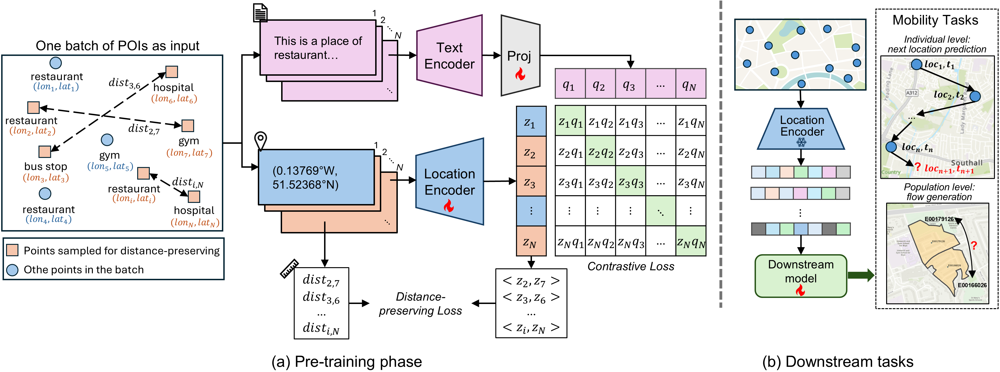

# LE4Mob

Official implementation of **LE4Mob: Towards Inductive, Distance-Aware and General-Purpose Location Embedding for Human Mobility Modelling**.

Many mobility models represent locations with ID-based lookup tables. These representations are tied to locations observed during training and do not explicitly encode how places relate in geographic space. LE4Mob instead learns a location encoder that maps coordinates directly to embeddings, allowing it to represent previously unseen locations.

During pre-training, LE4Mob aligns coordinate embeddings with textual place descriptions and uses a distance-preserving objective to encode spatial relationships. The resulting encoder is independent of a particular downstream model and can be reused across mobility tasks.



This repository directly supports three workflows:

- LE4Mob pre-training
- conventional and inductive next location prediction on FSQ-NYC
- commuter flow generation in London

## Structure

```text
le4mob/                 encoder, objectives, checkpoints, and pre-training
mob_tasks/next_location next location prediction models (i.e. MHSA), baselines, and evaluation
mob_tasks/commuter_flow London commuter flow generation workflow notebook and models
configs/                experiment configurations
data/                   prepared task data and evaluation membership
checkpoints/            released inference checkpoints and baselines
figs/                   paper figures
outputs/                generated runs (not versioned)
```

## Data

The prepared data required by the released workflows are included:

```text
data/
├── poi/fsq_nyc/                    POI tables for LE4Mob pre-training
├── next_location/fsq_nyc/          seven-day-history sequence splits
│   ├── conventional_test_set/      conventional evaluation membership
│   └── stratified_inductive_test_sets/
│       └── split_{0..4}/           combined inductive evaluation membership
└── commuter_flow/london/
    ├── flow/                        five train/validation/test flow splits
    └── representation/             precomputed Output Area representations
```

For LE4Mob pre-training, `nyc_tsmc_locs.csv` contains the conventional FSQ-NYC POI corpus. `nyc_tsmc_locs_remove10pct.csv` removes the union of locations held out by the five downstream inductive splits.

For next location prediction, the prepared sequence pickles are gzip-compressed and loaded directly by the code. Conventional training uses the shared train, validation, and test data. Inductive training uses five split-specific train and validation files; evaluation selects the reported samples from the shared test data using `combined_inductive.csv`. Samples whose target is unknown-location ID `1` are excluded from evaluation. The evaluation directories include manifests with sample counts and checksums.

For commuter flow generation, each numbered split contains aligned train, validation, and test flows. The representation directory contains LE4Mob, CaLLiPer, handcrafted, LDA, Space2Vec, SPPE, and Urban2Vec embeddings for the same London Output Areas.

Raw Foursquare check-ins and preprocessing details are available from the [Into-the-Unknown repository](https://github.com/xlwang233/Into-the-Unknown).

## Environment

```bash
conda env create -f environment.yml
conda activate le4mob
```

CUDA is used when available. Device selection can be changed in the relevant YAML configuration or through an available command line override.

## LE4Mob pre-training

Run the conventional FSQ-NYC setting with:

```bash
python -m le4mob.pretrain \
  --config configs/pretrain/fsq_nyc/le4mob.yaml \
  --setting conventional
```

Use `--setting inductive` for the held-out-location corpus formed from the union of the five downstream 10% splits. Pre-training writes resumable state, a lightweight `location_encoder.pt`, training history, and run metadata below `outputs/pretrain/`. Generated runs are ignored by Git; released inference encoders are under `checkpoints/pretrain/`.

## Next location prediction

Released encoders are included, so the downstream model can be trained directly. For conventional evaluation:

```bash
python -m mob_tasks.next_location.main \
  --config configs/downstream/next_location/fsq_nyc/next_location_conventional.yaml
```

For inductive evaluation:

```bash
python -m mob_tasks.next_location.main \
  --config configs/downstream/next_location/fsq_nyc/next_location_inductive.yaml
```

The evaluation protocol is defined by compact CSV membership files:

- `conventional_test_set/whole_test.csv` contains the conventional test membership;
- each inductive split stores the reported `combined_inductive.csv` membership; and
- all evaluation sets exclude samples whose target is unknown-location ID `1`.

Skip-gram, POI2Vec, TALE, TEASER, and CTLE configurations are provided under `configs/pretrain/fsq_nyc/baselines/`. For example:

```bash
python -m mob_tasks.next_location.run_pretrain \
  --config configs/pretrain/fsq_nyc/baselines/pretrain_skipgram.yaml \
  --inductive-pct 0
```

Use `--inductive-pct 10` for the inductive splits.

## Commuter flow generation

The commuter flow scripts are organised in [`commuter_flow_generation.ipynb`](mob_tasks/commuter_flow/commuter_flow_generation.ipynb), which presents the complete London experiment for readers to explore.

For details about the data layout and experiment configuration, see the [commuter flow README](mob_tasks/commuter_flow/README.md).

## Acknowledgements

This project builds on [CaLLiPer](https://github.com/xlwang233/CaLLiPer), [Into-the-Unknown](https://github.com/xlwang233/Into-the-Unknown), [CTLE](https://github.com/Logan-Lin/CTLE), and the [context-aware next location prediction](https://github.com/mie-lab/location-prediction). We thank the authors for their inspiring work.
